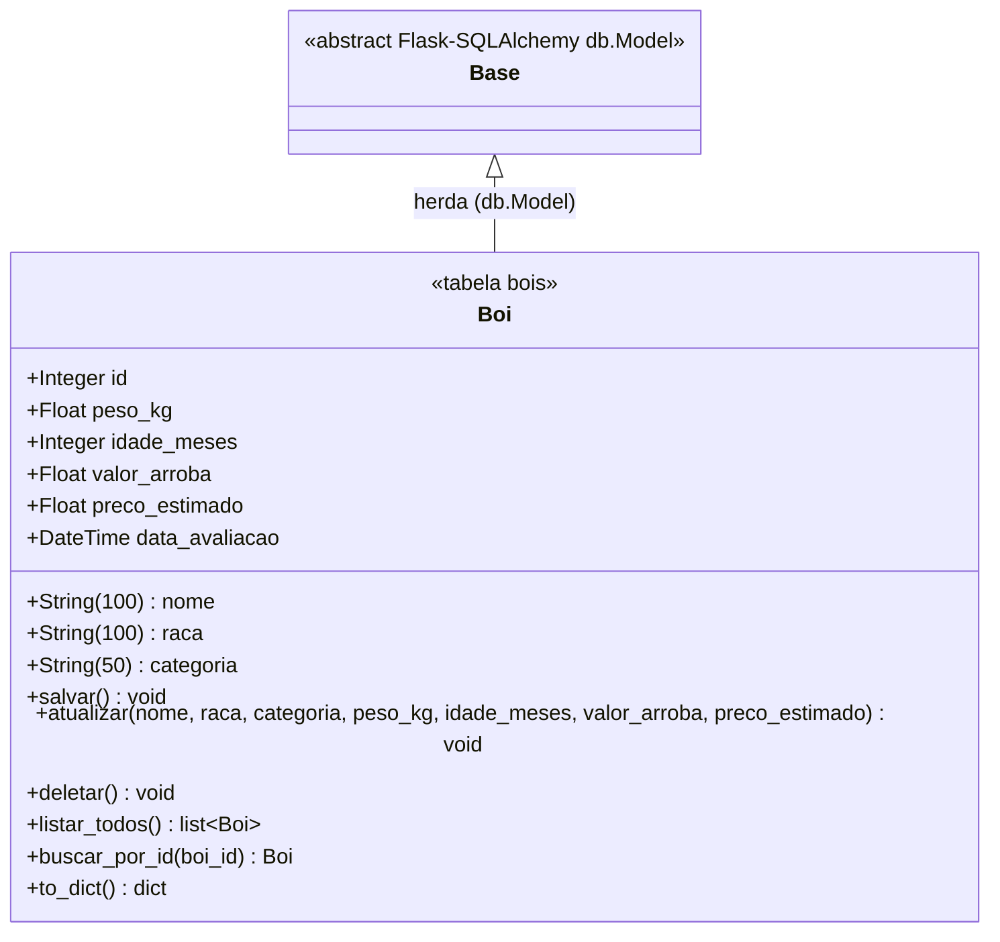
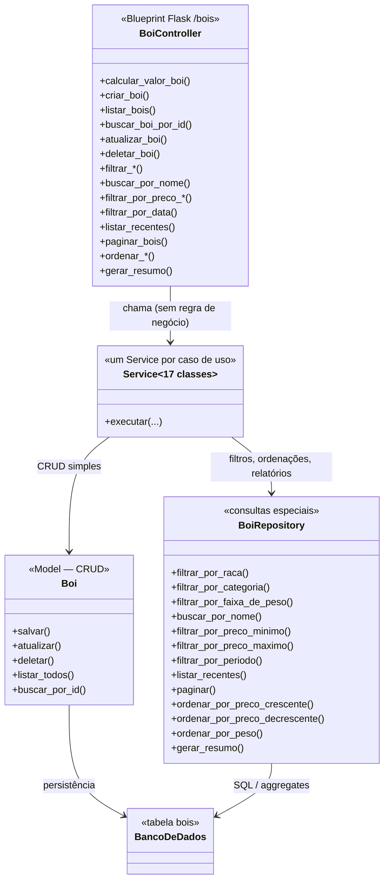

# Diagrama de Classes — AgroLogic

Diagrama do domínio do sistema, coerente com as Models implementadas em
`backend/models/` e com a arquitetura Controller → Service → Model/Repository
trabalhada na disciplina.

## 1. Domínio (entidades do banco)

**Notas sobre a entidade `Boi`:**

- **Herança:** `Boi` herda de `db.Model` (Flask-SQLAlchemy), exigência do enunciado
  para CRUD convencional. A classe pai `Base` representa essa classe-mãe do framework.
- **Persistência:** operações básicas (`salvar`, `atualizar`, `deletar`,
  `listar_todos`, `buscar_por_id`) estão na própria Model.
- **Atributo derivado:** `preco_estimado` não é digitado pelo usuário — é calculado
  pelo `CalcularValorBoiService` (`(peso_kg / 15) * valor_arroba`) e persistido junto.
- **Relacionamento:** o sistema possui uma única entidade de domínio (`Boi`), portanto
  não há associação, agregação ou composição entre entidades próprias do projeto.

## 2. Camadas do sistema (como as classes se relacionam)

**Regras de responsabilidade (conforme o material da disciplina):**

| Classe | Responsabilidade |
|---|---|
| `BoiController` | Recebe a requisição HTTP, interpreta os dados e devolve a resposta. **Não** contém regra de negócio. |
| `Service` (17 classes) | Um caso de uso por classe: valida, coordena e chama a Model ou o Repository. |
| `Boi` (Model) | Representa a entidade do domínio e concentra o CRUD básico. |
| `BoiRepository` | Somente consultas especiais: filtros, ordenações, paginação e agregações. Não repete CRUD. |
